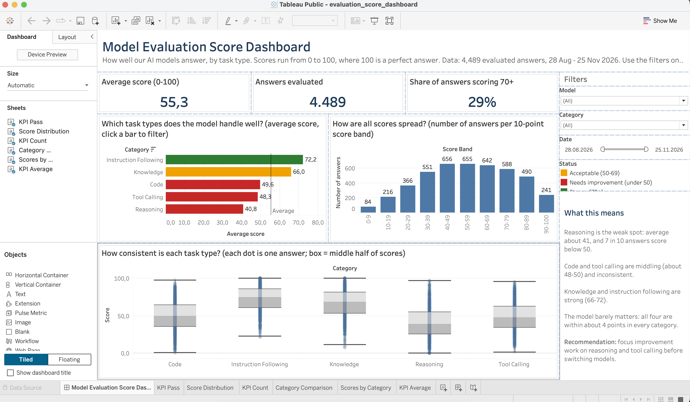

# Evaluation Dashboard: Ben Mayer

**Track:** Module 5, Evaluation & strategy · **When:** Week 8, Day 2 · **Tool:** Tableau (built and tested in Tableau Public 2026.3)

A stakeholder dashboard showing where the model succeeds and where it fails across five task types (reasoning, knowledge, code, instruction following, tool calling). It also includes the optional judge-agreement dashboard, which shows how far the scores can be trusted.



## The dashboards

**Model Evaluation Score Dashboard** (`evaluation_score_dashboard.twbx`)
- **KPI tiles:** average score, number of answers evaluated, share of answers scoring 70+.
- **Category Comparison:** average score per category, sorted, coloured strong / acceptable / needs improvement, with a line for the average across categories. Click a bar to filter the whole dashboard.
- **Score Distribution:** histogram of all scores in 10-point bands.
- **Scores by Category:** every answer as a dot, with a box plot per category, to show how consistent each category is.
- **Filters:** model, category and date range, applied to every chart.
- **"What this means" panel:** the takeaways in plain language, with a recommendation.

**Judge Agreement Analysis Dashboard** (`judge_agreement_dashboard.twbx`, optional extra)
- KPIs (agreement rate, average gap between judges, number of answers), agreement by category, a histogram of judge gaps, and a scatter of judge 1 vs judge 2 with a trend line. Filters: category and date.

**Headline:** reasoning (average about 41) and tool calling (about 48) are the weak spots, while instruction following (about 72) is strong. The four models are within about 4 points of each other, so the task type matters far more than the choice of model. The judges agree on only about 56% of answers, which is a reason to tighten the scoring guide before acting on small differences.

## File map

| File | Purpose |
|---|---|
| `evaluation_score_dashboard.twbx` | **Deliverable 1**: packaged Tableau workbook (data included) |
| `dashboard_screenshot.png` | **Deliverable 2**: screenshot of the main dashboard |
| `data_source.md` | **Deliverable 3**: which data I used and why |
| `reflection.md` | **Deliverable 4**: communication layer, dashboard vs. notebook, what I'd change |
| `judge_agreement_dashboard.twbx` / `judge_agreement_screenshot.png` | Optional extra: judge agreement dashboard and screenshot |
| `generate_evaluation_data.py` | Step 1: generates `evaluation_data.csv` and `judge_agreement_data.csv` (lab Option B, fixed seed and dates) |
| `clean_evaluation_data.py` | Steps 2-3: validates the data and writes `evaluation_data_clean.csv` |
| `build_tableau_workbooks.py` | Steps 4-11 as code: writes both workbooks' Tableau XML and packages it with a Hyper extract of the data into `.twbx` |
| `*.csv` | Raw, clean and judge-agreement data |

## Reproduce

```bash
pip install pandas numpy tableauhyperapi
python generate_evaluation_data.py
python clean_evaluation_data.py
python build_tableau_workbooks.py   # then open the .twbx files in Tableau Public / Desktop
```

## Notes

- **Data:** synthetic, from the lab's own generator. See `data_source.md`. Model versions are assigned at random, so the absence of model differences comes from the generator, not from real behaviour.
- **Workbooks as code:** I wrote the dashboards as Tableau XML from Python, not by clicking through the UI, so they're reproducible and reviewable in a PR. Then I opened, checked and screenshotted them in Tableau Public. The data is packaged as a Hyper extract because Tableau Public won't open live CSV connections. To read the XML, unzip a `.twbx`.
- Files are at the repo root rather than in a `lab_evaluation_dashboard_[name]/` folder, to keep the fork flat.
