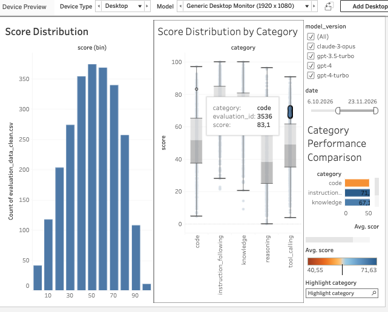

# Lab Proof: Evaluation Dashboard

**Tool:** Tableau Desktop Public Edition · **Data:** Option B, generated ([data_source.md](data_source.md)) · File map: [README.md](README.md)

## 1. Workflow (code and export)
1. [01_data_preparation.ipynb](01_data_preparation.ipynb): runs the lab generator script, checks and cleans the data, saves [evaluation_data_clean.csv](evaluation_data_clean.csv).
2. [02_visualizations.ipynb](02_visualizations.ipynb): Tableau connection and the three charts plus filters, each with reference numbers.
3. [03_dashboard.ipynb](03_dashboard.ipynb): dashboard layout, texts, KPI values, deliverable checks.
4. Tableau export: [evaluation_score_dashboard.twbx](evaluation_score_dashboard.twbx).

## 2. One run with its input
- **Input:** lab generator script, `np.random.seed(42)`, 5 categories, 4 model versions, 90 days, 5 to 15 evaluations per category per day.
- **Run:** `01_data_preparation.ipynb` generated 4489 evaluations from 26 Aug 2026 to 23 Nov 2026; all checks printed PASS (numeric scores, 5 consistent categories, YYYY-MM-DD dates, no missing values, 0 rows removed).

## 3. Evidence
Average score per category from the notebook, used to check the Category Comparison chart in Tableau (overall average 55.3):

| Category | Average score |
|---|---|
| instruction_following | 72.2 |
| knowledge | 66.0 |
| code | 49.6 |
| tool_calling | 48.3 |
| reasoning | 40.8 |

Filter test: with only gpt-4 selected, the Tableau averages matched the gpt-4 table in `02_visualizations.ipynb`.

## 4. Final output

Key takeaways shown on the dashboard:
1. Reasoning is the weakest area (average 40.8 of 100); 69% of these answers score below 50. Fix this before scaling use cases that need multi-step logic.
2. Instruction Following is the strongest area (average 72.2), ready for wider use.
3. All four models score within 2.3 points of each other: the type of task drives quality more than the choice of model.

## 5. Failure or limitation
- **Dates move on every run.** The generator builds dates from `datetime.now()`, so re-running notebook 01 on another day shifts the whole date range while the scores stay the same (the seed fixes only the random numbers). The Tableau date filter and KPI date range then no longer match the screenshot. Fix used: generate once, keep the CSV in the repo, and refresh the Tableau extract only when the data really changes.
- **Synthetic data.** The model version is assigned at random, so the near-equal model scores come from the generator, not from real model behaviour.
- **Reference line gotcha.** Tableau's default average line on the comparison chart averages the five bars (55.4), not all evaluations (55.3); the aggregation must be set to Total.
