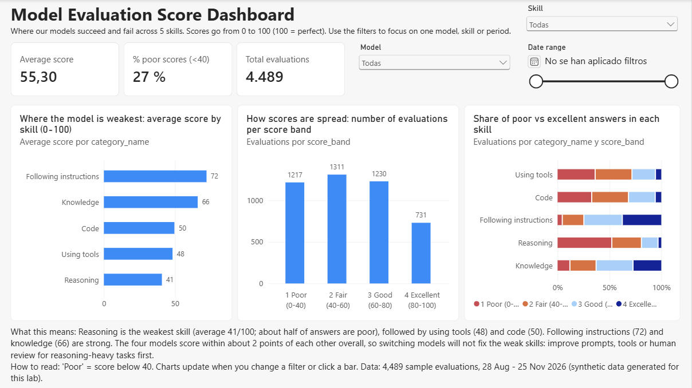

# Evaluation dashboard — Power BI

**Tool:** Power BI Desktop (free, Microsoft Store version, Spanish interface).

**Overview:** a one-page dashboard for non-technical stakeholders showing where models succeed and fail across 5 skills: three headline numbers, three charts (average score by skill, distribution of scores by band, share of poor-to-excellent answers in each skill), filters for model, skill and date, cross-filtering by clicking any bar, and a plain-English "what this means" note.



**Data:** 4,489 synthetic evaluations generated with the lab's script (see `data_source.md`).

**Start here:** [`lab_proof.md`](./lab_proof.md).

## File map

| File | What it is |
|---|---|
| `lab_proof.md` | Entry point for the reviewer: workflow, one query with its input, evidence, output, limitations |
| `evaluation_score_dashboard.pbix` | The Power BI dashboard file |
| `dashboard_screenshot.png` | Screenshot of the final dashboard |
| `data_source.md` | Which data was used and why |
| `reflection.md` | Communication-layer choices, what was included and excluded |
| `generate_evaluation_data.py` | Step 1: generates `evaluation_data.csv` (lab script, fixed date) |
| `clean_evaluation_data.py` | Steps 2–3: checks the data, adds plain-language columns, writes the clean CSVs |
| `evaluation_data.csv` | Raw generated data |
| `evaluation_data_clean.csv` | Clean data (comma-separated, dot decimals) |
| `evaluation_data_clean_powerbi_es.csv` | Same data for a Spanish-locale Power BI (`;` separator, `,` decimals): the file the dashboard imports |

## How to reproduce

```bash
python generate_evaluation_data.py
python clean_evaluation_data.py
```
Then open `evaluation_score_dashboard.pbix` in Power BI Desktop. If the data path differs on your machine: Transform data → Data source settings → Change source → `evaluation_data_clean_powerbi_es.csv`.
