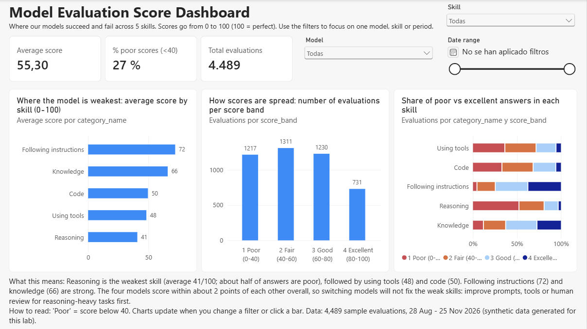

# Lab proof — Evaluation dashboard

## 1. Code and workflow
- Data: [`generate_evaluation_data.py`](./generate_evaluation_data.py) → [`clean_evaluation_data.py`](./clean_evaluation_data.py) → `evaluation_data_clean_powerbi_es.csv`.
- Power BI workflow (saved in [`evaluation_score_dashboard.pbix`](./evaluation_score_dashboard.pbix)):
  1. Get data → Text/CSV → `evaluation_data_clean_powerbi_es.csv` → Load (4,489 rows).
  2. Measures (DAX):
     ```
     Evaluations          = COUNTROWS('evaluation_data_clean_powerbi_es')
     Average score        = ROUND(AVERAGE('evaluation_data_clean_powerbi_es'[score]), 1)
     % poor scores (<40)  = DIVIDE(CALCULATE(COUNTROWS('evaluation_data_clean_powerbi_es'),
                                     'evaluation_data_clean_powerbi_es'[score] < 40),
                                   COUNTROWS('evaluation_data_clean_powerbi_es'))
     Total evaluations    = FORMAT(COUNTROWS('evaluation_data_clean_powerbi_es'), "#,##0")
     ```
  3. Visuals: clustered bar (Average score by `category_name`, sorted); column chart (Evaluations by `score_band`, sorted by band) as the histogram; 100 % stacked bar (Evaluations by `category_name` and `score_band`, red → dark blue); a card with the three headline numbers.
  4. Slicers: Model (dropdown), Skill (dropdown), Date range (between). Cross-filtering left on (default).
  5. Title, subtitle and a "What this means / How to read" note; canvas 1280 × 720.

## 2. One query with its input
Input: click the **Reasoning** bar in "Where the model is weakest" (cross-filter all visuals to `category_name = Reasoning`).

## 3. Evidence it produced
With the filter applied, the headline card changed from **55.30 / 27 % / 4,489** (all data) to **40.80 / 52 % / 879** (reasoning only), and the histogram highlighted 455 poor, 251 fair, 141 good and 32 excellent answers. This matches a check in Python on the same file (`evaluation_data.csv`): reasoning mean 40.8, 879 rows, 52 % below 40.

## 4. Final output


Key messages shown to stakeholders: reasoning is the weakest skill (41/100, about half of answers poor), then using tools (48) and code (50); following instructions (72) and knowledge (66) are strong; the four models are within about 2 points of each other overall (54.4–56.7).

## 5. Failures and limitations
1. **Decimal separator.** The first import read `17.18` as `1718`, because Power BI on a Spanish-locale Windows treats the dot as a thousands separator. Fixed by exporting a copy with `;` as separator and `,` as decimal mark (`evaluation_data_clean_powerbi_es.csv`); the original comma/dot file is kept for other tools.
2. **Card number format.** The new card visual displayed "4 mil" (automatic thousands). Instead of searching the formatting options, a text measure `Total evaluations` shows the exact figure (4,489, shown as "4.489" in the Spanish interface).
3. **Date slicer** shows "no filters applied" instead of the start and end dates; the slider still filters correctly.
4. **Mixed language.** Power BI's automatic subtitles ("Average score por category_name") come from the Spanish interface.
5. **Synthetic data.** Results show how the dashboard communicates, not real model performance; the footer says so.
6. **Optional judge-agreement dashboard** not attempted.
