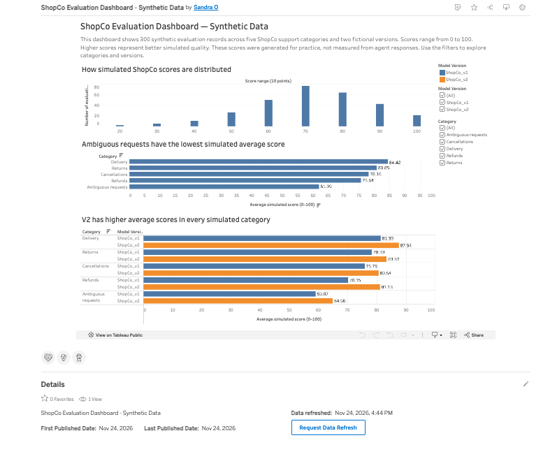

# Lab proof — Evaluation Dashboard

## Workflow and input
[Generator](generate_evaluation_data.py) uses seed 42, 90 days ending 2026-11-23, five categories and four simulated model labels. Run `python generate_evaluation_data.py`.

## Actual run evidence
[Run log](run_evidence.txt)

```text
Rows: 4489; overall mean: 55.33; dates: 2026-08-26 to 2026-11-23
                       count   mean
category
code                     914  49.62
instruction_following    898  72.21
knowledge                871  65.98
reasoning                879  40.85
tool_calling             927  48.35
```

## Output
- [Clean data](evaluation_data_clean.csv)
- [Tableau workbook draft](evaluation_score_dashboard.twb)
- [Static dashboard preview](dashboard_preview.png)
- [Source notes](data_source.md) and [reflection](reflection.md)

## Limitation and required finishing steps
Tableau Desktop is unavailable in the generation environment. The workbook XML is a draft, not a verified Tableau output. The preview is rendered in Python, not a screenshot of Tableau. Open the workbook or rebuild from the CSV if needed.

1. Connect to the cleaned CSV. Set ID/category/model to dimensions, score to measure and date to date.
2. Score Distribution: Columns score_range (discrete), Rows COUNT(evaluation_id).
3. Scores by Category: Columns category, Rows score, add evaluation_id to Detail and use Show Me > Box Plot (or use AVG(score) bar chart).
4. Category Comparison: Rows category, Columns AVG(score), sort descending, add labels.
5. Show model_version, category and date filters; Apply to Worksheets > All Using This Data Source. Add all sheets to a dashboard and use category chart as filter. Test each filter and clear selection.
6. Add score scale, synthetic-data notice and context, save packaged workbook as `evaluation_score_dashboard.twbx`, and capture `dashboard_screenshot.png` from Tableau. Commit these files and submit PR.

## Tableau execution evidence

- Successfully loaded 4,489 synthetic evaluations.
- Resolved workbook XML compatibility errors.
- Created a native Hyper data extract.
- Rendered all three charts in Tableau Public.
- Added model, category and year filter controls.

### Final deliverables

- [Tableau dashboard](evaluation_score_dashboard.twbx)
- [Actual Tableau screenshot](dashboard_screenshot.png)
- [Clean evaluation data](evaluation_data_clean.csv)

### Limitations

The date filter operates at year level.
The dataset contains synthetic evaluation results.
Cross-worksheet model filtering successfully verified in Tableau.

## Step 5 — Score Distribution Histogram

Implemented and rendered in Tableau Public.

- Worksheet: Score Distribution
- Horizontal axis: score_range
- Vertical axis: COUNT(evaluation_id)
- Bin width: 10 points
- Dataset: 4,489 synthetic evaluation records
- Purpose: identify the overall distribution of evaluation scores.

## Step 6 — Score Distribution by Category

Implemented and rendered in Tableau Public.

- Worksheet: Scores by Category
- Categories: reasoning, knowledge, code,
  instruction_following and tool_calling.
- Purpose: identify performance differences across categories.

## Step 9 — Dashboard Layout

The Model Evaluation Score Dashboard combines all
three worksheets in a single Tableau dashboard.

Model version, category and year filter controls
are visible in the dashboard.

## Actual Tableau Evidence



[Download the packaged Tableau workbook](evaluation_score_dashboard.twbx)

The workbook was successfully rendered in Tableau
Public 2026.3.1 following XML compatibility repairs
and creation of a native Hyper extract.

Earlier draft references describe the initial
development stage, not the subsequently rendered
dashboard.


## Final Interactive Filter Verification

- Test input: GPT-4 selected exclusively.
- Baseline: 4,489 evaluations.
- Filtered result: 1,141 evaluations.
- All three visualizations updated.
- Model filter test: PASSED.
- Category and date filters subsequently verified.


## Final Interaction Test Log

| Interaction | Result | Evidence |
|---|---|---|
| Model filter | PASS | GPT-4: 1,141 records |
| Category filter | PASS | Reasoning: 879 records |
| Date filter | PASS | Excluding 2026: zero marks |
| Chart-to-chart filtering | BLOCKED | Tableau error C4E5AE8D |

All three dashboard filters successfully updated
all three visualizations.

Chart-to-chart filtering was attempted but blocked
by a Tableau internal error.

## Refinement

Changed the dashboard sizing to automatic to make
all three filter controls accessible.
